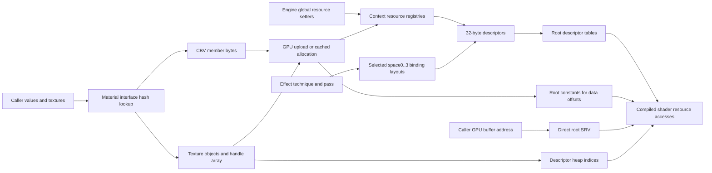

# SGD5 runtime parameter pipeline

The central pipeline is now traced from material initialization and caller setters through pass selection, descriptor construction, root arguments, and representative shader accesses. Evidence comes from static analysis of `game_scarlett_master.exe`, independent decoding of its SGD5 archive, and GFX10.3 ISA inspection. Addresses below use image base `0x140000000`. Runtime observations would still be useful for validating driver behavior and identifying original parameter names.

## Pipeline overview



There are distinct numbering schemes along this path: interface entry, material resource/CBV ordinal, member byte offset, material texture-handle slot, global registry ID, descriptor-table index, compiled register/space, root-parameter index, and ISA SGPR. A hash joins resource identities; it does not make these numbers interchangeable.

## Loading creates reusable definitions and interfaces

The archive loader `0x142499630` processes shared reflection before loading stage shaders and effects. The effect reader `0x14247B6C0` installs a shared/inline reflection source, main parameter reflection, separate property reflection, and binding layouts. Shared and main reflection use the registration helper `0x140F9FFA0`; compute shader initialization also calls it. These tables describe reusable logical resources and layouts rather than live material values.

The interface constructor `0x14247C8C0` selects exposed parameters from main reflection. Its 16-byte entries contain two hashes, a resource/CBV ordinal at +8, a resource/member reflection index at +10, and category at +12. Members of a CBV become individually addressable interface entries without becoming independent GPU descriptors. The constructor also resolves exposed resources to category-specific global registry IDs and builds compact per-pass lists of material resources to bind.

The `proplst` table remains a property dictionary used for classification, flags, and feature selection. It is separate from both the material parameter interface and the binding-list layouts.

## Caller data enters material storage

`0x141ADCE60` constructs a material instance referencing an effect. It allocates and zeros interface-sized storage; `0x1455AD1D0` establishes its CBV pointer array and resource array. For each CBV, `0x14555EED0` initializes linked defaults at the reflected member byte offsets, using the value-type byte size and `max(array_size, 1)`. Defaults are actual material initialization data.

The lookup wrapper `0x144F29860` searches primary hashes through `0x144F298A0` and secondary hashes through `0x144F298D0`, returning a one-based interface index. The second hash is consequently an alternate lookup identity. Its original source-level meaning remains uncertain.

The constant setter `0x144F96890` resolves the interface entry to its parent CBV and member, then copies caller bytes to `cbv_data + member.byte_offset`. It limits the copy to the reflected type/array extent. If a GPU cache exists, it updates the cache or replaces an allocation already marked as used before writing. This is the connection between caller values and reflection packing.

Concrete callers include `0x1400FA0B0`, which looks up a member hash and supplies a float value of 1, and `0x1409536B0`, which looks up a member and supplies two floats computed from an angle. These calls use the same member setter as serialized material loading.

For textures, `0x140293E90` supplies a resource hash and texture object across material groups. The setter `0x144F66840` updates the resource array, accounts for streaming references and reference counts, and invokes `0x144F669B0` to update a mapped handle slot. A texture assignment carries a resource object; it is not a raw shader register write.

Serialized material loading at `0x140325270`, called by group construction `0x1451E4180`, resolves the effect and relocates serialized pointers. Compatible interface layouts reuse stored data. When layouts differ, it constructs storage for the current effect, matches serialized parameter identities against the interface's secondary hashes, and transfers compatible values/resources. Packed value entries supply a CBV ordinal, byte offset, and byte extent; value transfer reaches `0x144F96890`. Texture entries resolve resident objects or streaming references and reach the texture setter. Material copying at `0x1412808C0` and cloning at `0x144F96570` provide additional routes into the same reflected storage.

The complete external material-file schema and every higher-level gameplay caller are outside this reconstruction. The relevant consumption of their values by effects is established.

## Material textures use descriptor-heap indirection

Eligible material SRVs use the main-effect reflection slot as an index into a u32 handle array. The binding-list header's high byte is its padded entry count, not a flag byte. `0x144F966A0` allocates the GPU cache and initializes handles; `0x144F669B0` updates individual handles, replacing used allocations when necessary. A resolved texture contributes:

```c
handle = (texture_descriptor_pointer - descriptor_heap_base) >> 5;
texture_handles[effect_resource.slot] = handle;
```

An absent mapping is `0xFF`. Zero is a valid mapped slot. A missing texture can use a shape-specific fallback handle.

For effects with a nonzero handle count, the u32 after a pass's four counted usage lists controls handle binding. `0x14247C8C0` converts its low byte into a flattened root-constant destination, with `0xFF` meaning absent, and adds a graphics/compute selector in the compact runtime plan. Values below `0x100` also enable the CBV fallback. All supplied control words are `0x100`, `0x101`, `0x102`, `0x104`, or `0x1FF`; their remaining bits stay preserved.

The cached binder `0x144DA8BD0` obtains the handle-array allocation's offset within the common GPU data buffer through `0x144DA8E10`. It writes one root-constant dword through `0x144DA1210` for graphics or `0x144E89080` for compute. The fallback exposes the handle array through the built-in CBV hash `0x5F759806`.

The `cable` sample closes this path. Three texture slots hold indices into the descriptor heap. Its pass control word `0x101` supplies the array offset as root-constant dword 1; the compiled root describes two constants at b500, space0. The shader reads the three handles from the common data-buffer SRV, hash `0x7B09BD38`, at the supplied offset and offsets +4/+8. It multiplies each index by 32, loads the corresponding descriptor from the heap, and samples using that descriptor.

The shared-buffer connection is independently confirmed: `0x140CC8170` resolves hash `0x7B09BD38` to a global SRV ID, and `0x1450CC390` / `0x1450CC5B0` install the engine's common buffer in that context entry. The base used to express material allocations is held alongside the common SRV/UAV objects. This texture path does not require an individual pass-table entry for each material texture.

## Global resources and CBVs join the pass layouts

Global setters can populate the rendering context directly. For example, `0x14555EE70` installs a texture into `context +64 +8*(packed_id >>2)`, marks its scope dirty, and clears pending descriptor state. `0x1450CC5B0` demonstrates both SRV and UAV installation. Material binding installs exposed resources into the same context registries using interface-resolved IDs.

`0x144DA8830` chooses `technique.first_pass + caller_pass`, its shaders and states, and its compact parameter plan. `0x144DA8BC0` selects cached binding (`0x144DA8BD0`) or CPU upload (`0x144DA8F70`). The CPU path uploads selected CBV data through `0x144E3D460`; the cached path uses existing allocations. `0x144DA8E30` / `0x144DA8E40` / `0x144DA8E70` construct CBV descriptors from buffer address, allocation offset, and byte size.

The binding converter `0x1408E8530` resolves serialized hashes through category-specific registries and translates binding kind/shape. Its compact runtime entry contains a global ID in bits0..10, translated kind in bits12..15, and descriptor index in bits16..25, plus retained flags. `0x144D9EFD0` uses the ID to fetch the current SRV/UAV/CBV descriptor, resolves pending or missing resources, and copies 32 descriptor bytes to `table_base +32*descriptor_index`.

The four selected layouts correspond to register spaces0..3. Graphics takes selectors from pass bytes18..21 and uses the last active graphics stage in VS/PS/GS/DS/HS order as root-signature owner. Compute takes selectors from shader metadata bytes88..91. Shared tables provide reusable layouts; inline tables provide effect-local layouts. A layout can contain resources unused by one particular stage of a combined pass.

## Compiled root signatures establish actual shader bindings

`0x140FA09F0` finds DXBC `PRIV`, checks prefix `DC E2`, and calls decoder `0x1455AC630`. It reconstructs and serializes a version-1.1 D3D root signature before creating the runtime root object. The SGD5 shader's separate 144-byte block is engine shader metadata, not this serialized root signature.

Each compact descriptor table identifies a register space and ordered SRV/UAV/CBV/sampler register lists. Its ranges each contain one descriptor with append placement. A binding entry's descriptor index selects the corresponding compiled range. Direct SRVs/UAVs and root constants have their own parameters. Samplers in the supplied corpus are static root samplers, with no sampler descriptor-table ranges.

Per-shader reflection encodes registers as:

```c
register = slot
         | ((resource_type & 0x0080) << 1)
         | ((resource_type & 0x2000) >> 4);
space = flags >> 6;
category = (resource_type >> 4) & 3;
```

Bit `0x0080` is register bit8, not an independent resource flag. Bit `0x2000` is register bit9 and is absent from this corpus. For example, type `0x0485` and slot109 encode t365. These per-shader semantics must not replace main-effect texture-handle slot semantics.

Root information construction at `0x142476D40` records the four table root indices and indices/counts for direct descriptors and constants. Graphics flush `0x14555E640` reaches `0x140032130`; compute flush `0x14248CA90` reaches `0x14248C2A0`. The graphics path submits tables through command-list virtual +288, constants through +320, root SRVs through +352, and root UAVs through +368. Its fast path emits software command records using the command-list root map; this analysis does not establish those records as raw PM4.

A direct root-SRV caller is traced too. `0x144E96C00` obtains a buffer address and extent from caller data. Setter `0x144F80240` adjusts a mapped GPU alias when needed, stores the address at context +55872 and extent at +55904, and marks root-SRV state dirty. `0x140032130` submits that address at the compiled direct-root parameter. The supplied shader reflection joins the direct SRV hash `0x054818B2` to registers in space3.

## ISA evidence and compiler ABI limits

The pixel sample confirms its space0 table arrives in s8 and its space1 table in s9. A space0 descriptor load at byte offset `0x6A0` selects descriptor53 and joins hash `0x6E8725E4` to t14, space0. Another at `0xA80` selects descriptor84 and joins the common data-buffer hash to t20, space0. Its material handle-array offset is used from s14; s15 supplies the descriptor-heap base, consistent with the root's direct-resource-heap flag `0x400`.

The compute sample confirms a space1 table supplied in s5. Its loads at offsets0, `0xA0`, and `0xC0` select descriptor indices0, 5, and 6, corresponding to t244, u22, and b23 in space1. These examples connect root tables to actual scalar descriptor loads and subsequent shader operations.

This build's compute FSSM descriptor stores `COMPUTE_PGM_RSRC2` at +`0x78` and thread dimensions at +`0x7C`/+`0x80`/+`0x84`. All 2,689 compute shaders' dimensions match their independent DXBC `PSV0` runtime-info fields. XCL's shorter retail descriptor uses +`0x38` and +`0x3C`/+`0x40`/+`0x44`; applying those offsets to this build gives invalid dimensions. The sample has seven user SGPRs and a compiled group size of 64×1×1.

XCL's compiler-tested reference describes root arguments starting at s4 for compute and s8 for graphics, with whole-parameter spilling to a separate argument table. The inspected examples agree with the relevant inline arguments. Direct heap indexing adds compiler/driver inputs: the pixel sample's s15 is the resource-heap base, which explains the extra SGPR after its ordinary root arguments. A universal prediction for every stage, spilled parameter, sampler heap, and driver-reserved register has not been proven. PercyStar therefore displays verified root/register metadata and preserves ISA operands instead of automatically assigning parameter names to arbitrary SGPRs.

The investigation found two interpretation bugs in the old disassembler: SMEM's scalar offset operand was dropped, and several SOP2 mnemonics used incorrect opcode numbers, including the shift needed to scale a descriptor index by32. Buffer SMEM bases also need four SGPRs. The parser now retains scalar offsets and displays descriptor widths correctly; synthetic ISA tests cover the fixes.

## Validation and tool support

Independent analysis and the Rust archive regression agree on:

| Check | Result |
| --- | ---: |
| Compiled PRIV roots decoded | 26,503; zero failures |
| Per-shader reflection resources matching roots | 413,468; zero unmatched |
| Resources using high register bits | 59,560 |
| Pass-selected layouts matching root range counts | 76,603 |
| Binding-entry category/index occurrences matched | 5,274,062 |
| Named selected-shader resources matching table registers | 418,257 |
| Remaining selected-shader resources matching direct roots/constants | 21,807 |

There are 28,798 passes, including one shaderless pass. All 26,503 roots' direct-resource counts and constant dword counts agree with the corresponding packed shader-metadata word at +8. All 357,745 sampler occurrences decode as static samplers; no root UAV parameters are observed, although the executable and decoder support them.

PercyStar now decodes compact PRIV roots and shows compiled registers/spaces, root locations, static sampler state, per-pass verified layout joins, texture-handle controls, and compute thread dimensions/user SGPR counts. Its effect → technique → pass → shader browser preserves the selected context, with dedicated parameter inspection and matching metadata in ASM/HLSL exports. Effect state, material/default data, typed property records, and vertex metadata are also exposed. Resource names remain hash-resolved metadata. Texture element types, complete source reconstruction, and universal SGPR allocation are separate questions; these findings improve disassembly and decompilation context without claiming those are solved.

The archive regression is opt-in through `PERCY_SGD5_SAMPLE`. Executable/shader dumps and captured disassembly remain local analysis artifacts.

The compiler's FSSM root-layout and used-resource tables now provide per-program input locations without assuming a universal root-packing rule. All 26,698 native programs in the 26,503 SGD5 containers decode, including the alternate VS/ES programs in 195 containers. All 385,337 compiler table-resource entries agree with `PRIV` and shader reflection; compute dimensions still agree with `PSV0`. Graphics user-data locations account for the actual hardware stage, including the system SGPR prefix in mesh/merged stages. This completes metadata-level parameter-to-entry-ABI joins; identifying a particular descriptor use through copies, dynamic arithmetic or control flow remains an ISA data-flow task. See [FSSM.md](FSSM.md).
